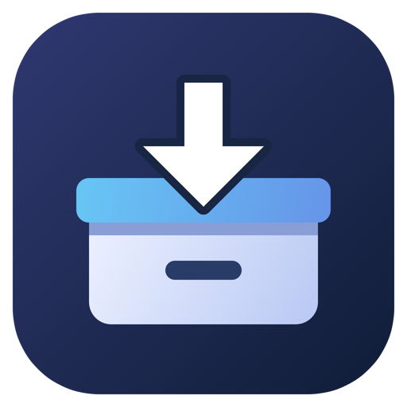

# takedown

**Download your Google Takeout archives to your own storage.**

takedown is a native desktop app and CLI for downloading Drive-delivered Takeout
archives and exports from Google's Data Portability API. Choose a local folder,
mounted share, Windows UNC path, SMB2/3 share, or SFTP destination.

[Download CI builds](https://github.com/Dunky13/takedown/actions/workflows/ci.yml) · [Quickstart](#quickstart-drive-delivered-takeout) · [Privacy](PRIVACY.md) · [Apache-2.0](LICENSE)

## What it does

- **Desktop and terminal:** the same executable opens the Fyne GUI with no
  arguments, or runs CLI commands. The GUI includes Drive folder navigation, a
  Data Portability resource catalog, job controls, diagnostics, and progress.
- **Download once or keep watching:** fetch ready archives, poll for new ones,
  or explicitly register a watch at user login. JSON output is available for
  archive lists, job receipts, diagnostics, and download status.
- **Resume interrupted transfers:** retain partial files and durable checkpoints,
  validate source identity before appending, and retry temporary failures with
  backoff. Ctrl+C retains resumable work.
- **Check space and archive integrity:** reserve space across workers, pause when
  capacity runs low, check ZIP entry checksums or complete gzip streams, and
  record SHA-256 digests for restart checks. Archives are not extracted.
- **Use documented Google APIs:** authorize through your system browser, keep
  OAuth tokens in the OS keyring, and explicitly manage Data Portability exports.
  Passwords and MFA stay in Google's browser flow.

takedown is an independent project and is not affiliated with or endorsed by
Google. Google verification or approval of this app has not been established.
Live Google account testing remains the user's responsibility.

## Download and run

Open [Native CI in GitHub Actions](https://github.com/Dunky13/takedown/actions/workflows/ci.yml),
select a successful run for the intended commit, and download its
`unsigned-native-*` artifact for your platform. These are **unsigned development
builds**, not signed or notarized releases. GitHub sign-in and repository access
may be required; artifacts expire after seven days.

| CI target | Packages |
| --- | --- |
| macOS Apple Silicon (arm64) | App ZIP and DMG |
| macOS Intel (amd64) | App ZIP and DMG |
| Windows (amd64) | Portable ZIP and per-user installer |
| Linux (amd64, Ubuntu 24.04 build host) | TAR.GZ with per-user install/uninstall scripts |

Each artifact includes `SHA256SUMS`. Verify it from the package directory with
`shasum -a 256 -c SHA256SUMS` on macOS or `sha256sum -c SHA256SUMS` on Linux.
Checksums detect changed bytes; they do not authenticate the publisher.
Unsigned apps can trigger operating-system trust prompts.

Launch the app to use the GUI. CLI commands use the same executable: inside a
macOS bundle it is `takedown.app/Contents/MacOS/takedown`; Windows uses
`takedown.exe`; the Linux archive contains `bin/takedown`. The examples below use
`takedown`, assuming its directory is on `PATH`. For a source build, substitute
`./bin/takedown` or `.\bin\takedown.exe` on Windows.

See [CI builds and artifact retrieval](docs/CI-BUILDS.md) for revision checks,
download commands, and the exact native matrix, and
[package installation](docs/RELEASING.md#unsigned-local-packages) for installation
and removal. A successful build does not establish interactive GUI or live
Google/network-storage acceptance on that platform.

## Quickstart: Drive-delivered Takeout

1. **Configure your Google project.** Follow Google's
   [desktop OAuth setup](https://developers.google.com/identity/protocols/oauth2/native-app)
   to enable the Google Drive API and create a **Desktop app** OAuth client.
   Configure the consent screen with the required `drive.readonly` scope and,
   when using an external app in Testing, add your account as a test user.
   Download the client JSON to a private file such as `./oauth-client.json`.
   Do not commit it.
2. **Create your export.** In [Google Takeout](https://takeout.google.com/), choose
   **Add to Drive**, your products, archive format, and any recurring schedule.
   Wait for Google to deliver the archives, then copy the containing Drive folder
   link. Google's [Takeout guide](https://support.google.com/accounts/answer/3024190?hl=en)
   explains the delivery options. Existing email-link exports must be downloaded
   through Google's interface or recreated with a supported delivery method.
3. **Authorize and download.** Use the GUI's setup controls, or run:

   ```sh
   takedown auth --source drive --oauth-client ./oauth-client.json --drive-folder 'https://drive.google.com/drive/folders/FOLDER_ID'
   takedown list --json
   takedown download --destination ./archives
   ```

   Replace `FOLDER_ID` with your actual folder ID. Complete Google's sign-in and
   consent in your system browser. Successful authorization saves the client,
   source, and folder preferences. To keep checking for new ready archives:

   ```sh
   takedown watch --destination ./archives
   ```

**Drive permission is read-only but broad.** The restricted `drive.readonly`
scope permits viewing and downloading **all your Drive files**, even though
takedown limits discovery to your selected folder and descendants. The narrower
`drive.file` scope does not automatically cover Google-created archives and
future files in that folder. Public distribution requires the applicable Google
verification process; publishing source or passing tests does not establish
approval. See [Google's Drive scope requirements](https://developers.google.com/workspace/drive/api/guides/api-specific-auth).

A functioning, unlocked OS keyring is required: macOS Keychain, Windows
Credential Manager, or Linux Secret Service. Tokens refresh while Google's grant
remains valid; revoked or expired authorization requires explicit sign-in again.
External OAuth apps in Testing can receive refresh tokens that expire after
seven days. See [Google's token expiration guidance](https://developers.google.com/identity/protocols/oauth2#expiration).

`takedown export --source drive` opens Takeout setup in your browser; you complete
the export choices. Watching never opens sign-in or creates exports implicitly.
Use `takedown auth --forget` to remove this profile's local authorization, then
[Google Account permissions](https://myaccount.google.com/permissions) if you also
want to revoke Google's remote grant. Neither action deletes downloaded files.

## Data Portability exports

This separate source creates new exports for eligible accounts and supported
products. It has [different product coverage](https://developers.google.com/data-portability/user-guide/scopes)
from Takeout and cannot retrieve existing email-link exports. Follow Google's
[API setup](https://developers.google.com/data-portability/user-guide/setup) and
[verification requirements](https://developers.google.com/data-portability/user-guide/overview),
including project billing, then configure a separate OAuth grant with only the
resource groups you need. The GUI provides a searchable resource catalog.

**Establish encrypted storage before using this source.** Google's
[Data Portability policy](https://developers.google.com/data-portability/policy)
requires protection in transit and at rest. takedown does not encrypt destination
files or verify storage encryption. SFTP protects transit only; direct SMB
encryption depends on the server and share configuration. An encrypted volume
or appropriately protected network destination is an operator prerequisite.

```sh
takedown auth --source portability --oauth-client ./portability-client.json --resources myactivity.search
takedown export
takedown watch --destination ./archives
```

Export creation is explicit. `list` and `watch` never create exports. One-time
and time-based grants have different limits; the app observes the five-minute
job polling minimum and 24-hour spacing between time-based export requests.
See [Google's API workflow](https://developers.google.com/data-portability/user-guide/introduction).

Inspect recorded jobs with `takedown jobs list --source portability --json`.
The GUI and CLI also expose grant inspection, retry, cancellation, archival,
reconciliation, and authorization reset. **Retain uncertain request receipts;
never guess a job ID or delete history to retry a lost response.** Authorization
reset revokes Google's grant and can remove access to old remote archives.
Read [recovery and job management](docs/AUTOMATION.md#recovery-and-job-management)
before using these controls.

## CLI and background use

```sh
takedown gui
takedown download --export EXPORT_ID --destination ./archives --part-by-part
takedown watch --poll-interval 5m --destination ./archives
takedown status --json
takedown doctor
takedown service install --dry-run
```

`download` selects all ready archives unless `--export` narrows the selection.
`--part-by-part` downloads sequentially while space permits; unattended work must
select it explicitly when the whole batch does not fit. `--workers` accepts 1
through 16 (default 2), and `--safety-buffer` retains free bytes (default
2,000,000,000). Polling defaults to five minutes, with a one-minute minimum for
Drive and five minutes for Data Portability.

Preferences and checkpoints live in the platform's user configuration directory
under `takedown`; `--data-dir ./private-data` selects another profile directory.
The GUI, successful `auth`, and export setup save preferences; download/watch
flags apply to that invocation. `--email` is a browser login hint and local
profile slot, not verified account identity. Keep it consistent between runs.
Help and status require neither Google credentials nor keyring access.

`doctor` checks local setup. `--online` explicitly probes Google; `--storage`
connects to the destination and checks capacity, potentially creating its
directory. Neither proves destination encryption.

After saving preferences and authorization, `service install` starts a watch
and registers it for the current user's login session using launchd, a systemd
user service, or a Windows interactive Scheduled Task. It needs an unlocked
keyring, stable executable path, and saved destination access. Use
`service remove` before moving or uninstalling the binary. See
[diagnostics and unattended watching](docs/AUTOMATION.md#diagnostics-and-unattended-watching)
for setup, changed preferences, and credential removal.

## Network storage

```sh
takedown download --destination 'smb://operator@nas.example/backups/takeout'
takedown download --destination 'sftp://operator@nas.example/exports/takeout' --ssh-key ./keys/archive --known-hosts ./keys/known_hosts
```

On Windows, an accessible share also works directly:

```powershell
takedown.exe download --destination '\\server\share\takeout'
```

For password-based SMB/SFTP, use the GUI's masked destination-password field or
provide `TAKEDOWN_STORAGE_PASSWORD` privately in the environment. For unattended
work, `takedown storage auth --destination 'smb://operator@nas.example/backups/takeout'`
explicitly saves destination access in the OS keyring; `storage forget` removes
it. Do not put passwords in URLs. Establish SFTP host-key trust independently in
the configured `known_hosts` file.

Network storage must support seeking, regular files, and rename operations.
SFTP requires `fsync@openssh.com` for durable checkpoints and `statvfs` for capacity
checks. `--allow-unknown-space` explicitly permits SFTP servers without free-space
reporting, with a warning; capacity cannot then be guaranteed. Changing the
destination starts downloads there without moving existing bytes. See
[destination access and unattended storage](docs/AUTOMATION.md#diagnostics-and-unattended-watching)
and [restart integrity](docs/AUTOMATION.md#restart-integrity-and-retry-behavior).

## Build from source

Use **Go 1.26.10**, the version pinned by `go.mod` and CI, and Fyne **v2.8.2**
from the module dependencies. The desktop build requires Cgo, a C compiler, and
the platform's graphics development files. Install prerequisites first:

| Host | Native build prerequisites |
| --- | --- |
| macOS | Xcode command line tools (`xcode-select --install`), including Clang and the macOS SDK |
| Windows | MinGW-w64 GCC on `PATH`; GNU Make and a compatible shell for Make targets |
| Linux | GCC, pkg-config, X11 and Wayland development files, OpenGL/EGL, and a working graphics session to launch the GUI |

On Debian/Ubuntu, including the Ubuntu 24.04 CI host:

```sh
sudo apt-get install build-essential pkg-config libgl1-mesa-dev libegl-dev \
  xorg-dev libwayland-dev libxkbcommon-dev libdbus-1-dev
```

The pinned GLFW module enables both X11 and Wayland by default, so both sets of
headers and EGL are needed. Other distributions need equivalent packages; see
[GLFW's platform dependencies](https://www.glfw.org/docs/3.4/compile.html#compile_deps)
and [Fyne's build requirements](https://docs.fyne.io/started/). Fyne does not
require WebKit2GTK.

From the repository root on macOS or Linux with GNU Make:

```sh
go mod download
make build
./bin/takedown
```

On Windows with MinGW-w64 GCC available, PowerShell can build directly:

```powershell
go mod download
go build -p 2 -trimpath -o bin/takedown.exe ./cmd/takedown
.\bin\takedown.exe
```

For a server without graphics development libraries, `make headless` produces
`bin/takedown-cli`. It retains the CLI commands and requires the same explicit
OAuth setup and keyring access. Cross-compiling the GUI also needs a target C
compiler, SDK, and graphics libraries; setting `GOOS` alone is insufficient.
See the [native build and packaging guide](docs/RELEASING.md#prerequisites).

Development checks are `make check` and `make test`. Tests use fake credentials,
local HTTP/storage fixtures, and Fyne's software test driver; they do not sign
into Google or modify the real keyring. The `ci` build tag selects that test
driver and must not be used for desktop packages.

## Documentation and license

- [Automation and operator setup](docs/AUTOMATION.md): API boundaries, advanced
  jobs, recovery, diagnostics, watch/service setup, and network authorization.
- [CI builds](docs/CI-BUILDS.md): supported native targets and unsigned downloads.
- [Packaging and signing](docs/RELEASING.md): installation, removal, prerequisites,
  and separately configured signing/notarization.
- [Privacy policy](PRIVACY.md): permissions, data handling, retention, and deletion.

Copyright 2026 Marc Went. takedown is licensed under the
[Apache License 2.0](LICENSE); see [NOTICE](NOTICE). Dependencies retain their
original licenses, documented in [THIRD_PARTY_NOTICES.md](THIRD_PARTY_NOTICES.md).
